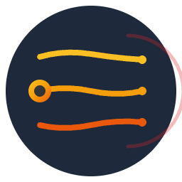

<p align="center">
  <a href="https://lanes.pro">
    
  </a>
</p>

# Lanes: AI Project Management

**Manage multiple, isolated AI coding sessions across VS Code and the terminal.**

Lanes uses Git Worktrees to give every agent session its own isolated file system and dedicated terminal. Supports Claude Code, Codex CLI, Google Antigravity CLI, legacy Gemini CLI, Cortex Code, OpenCode, and Pi out of the box. No more context contamination. No more half-finished files clashing with each other.

<video src="https://raw.githubusercontent.com/FilipeJesus/lanes/main/media/lanes-demo.mp4#t=4" autoplay loop muted playsinline controls alt="Lanes in action"></video>

---

## Features

- **True Isolation** - Each session gets its own Git worktree and dedicated terminal
- **Session Resume** - Automatically resumes where you left off using each agent's native session support
- **Session Aliases** - Right-click a session in Active Sessions and choose **Rename** to save a display name while keeping its branch and worktree names
- **Real-Time Status** - See which agents are working, waiting, or have errors
- **Session Hierarchy** - Sessions created by a lane through MCP appear beneath their parent in Active Sessions, with expandable children and workflow details
- **Built-in Diff Viewer** - Review all changes before merging back
- **One-Click Cleanup** - Delete the worktree when done, keep the branch for merging
- **Workflow System** - Optional MCP-based workflows guide agents through structured phases (plan → implement → test → review)
- **Multi-Agent Support** - Claude Code, Codex CLI, Antigravity, Gemini CLI, Cortex Code, OpenCode, and Pi with inline logo selector
- **File Attachments** - Drag-and-drop files into the session form to include with your prompt
- **Tmux Terminal Backend** - Persistent tmux sessions via `lanes.terminalMode` setting
- **Local Settings Propagation** - Auto-propagate `.claude/settings.local.json` and `.gemini/settings.json` to worktrees

Visit [our website](https://lanes.pro) for more information.

---

## Available On

| Platform | Status | Install |
|----------|--------|---------|
| **VS Code** | Stable | [Marketplace](https://marketplace.visualstudio.com/items?itemName=FilipeMarquesJesus.lanes) · [Open VSX](https://open-vsx.org/extension/FilipeMarquesJesus/lanes) |
| **CLI** | Stable | [From source](https://github.com/FilipeJesus/lanes/tree/main/src/cli) |

---

## Feature Comparison

| Feature | VS Code | CLI |
| --------- | :-------: | :---: |
| Create / list / delete / open sessions | ✓ | ✓ |
| Clear sessions | ✓ | ✓ |
| Pin/protect sessions | ✓ | — |
| Rename sessions with display aliases | ✓ | — |
| View git diff | ✓ | ✓ |
| Repair broken worktrees | ✓ | ✓ |
| Claude Code / Codex / Antigravity / Gemini / Cortex / OpenCode / Pi | ✓ | ✓ |
| Workflow templates (built-in + custom) | ✓ | ✓ |
| MCP-based workflows | ✓ | ✓ |
| Integrated terminal | ✓ | N/A |
| Tmux backend | ✓ | ✓ |
| File attachments | ✓ | — |
| Search in worktree | ✓ | — |
| Chime notifications | ✓ | — |
| Session insights | ✓ | ✓ |
| Status hooks | ✓ | ✓ |
| Local settings propagation | ✓ | ✓ |

---

## Quick Start

### Platform Support

- **macOS** - Fully supported
- **Linux** - Fully supported
- **Windows** - Not currently supported (WSL may work)

### Prerequisites

```bash
# Install Claude Code
npm install -g @anthropic-ai/claude-code
claude login

# Install jq (required for status tracking)
brew install jq          # macOS
sudo apt-get install jq  # Ubuntu/Debian

# Optional: Install Codex CLI for OpenAI agent support
npm install -g @openai/codex

# Optional: Install Google's current Antigravity CLI
curl -fsSL https://antigravity.google/cli/install.sh | bash
agy

# Legacy Google harness
npm install -g @google/gemini-cli
gemini

# Optional: Install modern OpenCode
npm install -g opencode-ai

# Optional: Install Pi (Node.js 22.19+)
npm install -g --ignore-scripts @earendil-works/pi-coding-agent
```

### Install

#### VS Code (Marketplace)

Search for **"Lanes"** in the VS Code Extensions marketplace, or visit the [VS Code Marketplace](https://marketplace.visualstudio.com/items?itemName=FilipeMarquesJesus.lanes).

**From Source:**

```bash
git clone https://github.com/FilipeJesus/lanes.git
cd lanes && npm install
npm run compile && npx vsce package
# Then install the .vsix via "Extensions: Install from VSIX..."
```

Or use the local install script: `./scripts/install-local-vscode.sh`

#### CLI (From Source)

```bash
git clone https://github.com/FilipeJesus/lanes.git
cd lanes && npm install && npm run compile
npm link
lanes --help
```

---

## Usage

### VS Code

1. Open the **Lanes** sidebar
2. Fill in **Session Name** and optionally a **Starting Prompt**
3. Click **Create Session**
4. A terminal opens with Claude running in an isolated worktree

Click any session to resume it. Click the trash icon to delete (branch is preserved for merging).

#### Quick Start

Use the **rocket button above New Session** (or run **Lanes: Quick Start** from the Command Palette) to open the configured agent directly in the base repository. Every click creates a new independent quick session, so you can run multiple sessions with the same agent in the same repository. New quick sessions start without an initial prompt. Quick sessions appear in **Active Sessions** and can be resumed after closing their terminal, renamed, pinned, cleared, or deleted. Select an existing session in Active Sessions to resume it. Metadata is stored under `.lanes/current-sessions/` without creating a worktree. Quick sessions omit Git changes, workflow state, and worktree search actions.

Every MCP-capable Lanes session receives the `session_create` tool. Sessions with an assigned workflow template also receive the workflow tools and `session_clear`. Quick Start currently supports **Claude Code** and **Codex**, whose CLIs accept MCP configuration without modifying project agent settings.

### CLI

```bash
lanes create my-feature --prompt "Implement the login page"
lanes list
lanes open my-feature
lanes diff my-feature
lanes delete my-feature
```

---

## Google Harness Notes

- **Antigravity CLI** (`antigravity`, executable `agy`) is the recommended Google harness. Lanes stores workflow MCP configuration in `.agents/mcp_config.json`.
- **Gemini CLI** (`gemini`) remains available for existing sessions but is Google's legacy harness. Lanes uses `.gemini/settings.json` for hooks and workflow MCP configuration.
- Both integrations use their native conversation IDs for resume.

## Pi Harness Notes

Select **Pi** in the session form, set `lanes.defaultAgent` to `"pi"`, or run `lanes create --name my-feature --agent pi`. Run `pi` and `/login` first to configure a provider.

Pi runs with full tool access; it has no native Lanes permission restriction modes. Lanes stores each conversation in a separate JSONL file under `.lanes/current-sessions/<session>/` and resumes that exact file, including sessions started without a prompt. In VS Code, log activity drives working/waiting status rather than command hooks.

Lanes requires an official Pi release with native `pi mcp` support (available in Pi 1.2.0 and later). Update older installations with `npm install -g --ignore-scripts @earendil-works/pi-coding-agent`. Workflows use Pi's native `.pi/mcp.json`; trust the worktree in Pi to enable project MCP servers. Lanes preserves other servers and `.pi/settings.json`. The local settings propagation option copies or symlinks both Pi files to new worktrees. See the [Pi CLI](https://github.com/earendil-works/pi/blob/main/packages/coding-agent/docs/cli.md) and [MCP documentation](https://github.com/earendil-works/pi/blob/main/packages/coding-agent/docs/mcp.md).

---

## Commands

| Command | Description |
| --------- | ------------- |
| `Lanes: Create Session` | Create a new isolated session |
| `Lanes: Quick Start` | Launch Claude Code or Codex in the base repository with Lanes MCP access, without a worktree |
| `Lanes: Open Session` | Open/focus an existing session's terminal |
| `Lanes: Delete Session` | Remove a session's worktree and terminal |
| `Lanes: Clear Session` | Reset session state while preserving the worktree |
| `Lanes: Show Git Changes` | Open the diff viewer for a session |
| `Lanes: Create Terminal` | Create an additional terminal for a session |
| `Lanes: Search in Worktree` | Open VS Code search scoped to a session's worktree |
| `Lanes: Repair Broken Worktrees` | Fix broken worktrees after container rebuilds |
| `Lanes: Setup Status Hooks` | Configure Claude hooks for status indicators |

### CLI Commands

| Command | Description |
| --------- | ------------- |
| `lanes create <name>` | Create a new isolated session |
| `lanes list` | List all sessions |
| `lanes open <name>` | Open/resume a session |
| `lanes delete <name>` | Delete a session's worktree |
| `lanes clear <name>` | Reset session state, preserve worktree |
| `lanes diff <name>` | Show git diff for a session |
| `lanes repair` | Fix broken worktrees |
| `lanes insights <name>` | Show session insights |
| `lanes pin <name>` | Pin/protect a session |
| `lanes unpin <name>` | Unpin a session |
| `lanes status` | Show status of all sessions |
| `lanes workflow <name>` | Run a workflow template |
| `lanes config` | View/edit configuration |

---

## Advanced

- **[Claude Harness & Workflows](docs/CLAUDE-HARNESS.md)** - Structured task management and MCP-based workflow guides for long-running sessions
- **[Website](https://lanes.pro)** - Full documentation and guides

---

## Roadmap

- [x] Session status indicators (idle, working, waiting)
- [x] Session resume functionality
- [x] Session templates for common workflows
- [x] Multi-agent support (Claude Code + Codex CLI)
- [x] File attachments in session form
- [x] Tmux terminal backend
- [x] Local settings propagation to worktrees
- [x] Additional agent integrations
- [x] Standalone CLI
- [ ] Windows support
- [ ] Multi-repo support

---

## Contributing

Contributions are welcome!

### Development Setup

```bash
git clone https://github.com/FilipeJesus/lanes.git
cd lanes
npm install
```

Press `F5` in VS Code to launch the Extension Development Host.

### Scripts

```bash
npm test          # Run tests
npm run lint      # Run ESLint
npm run compile   # Compile TypeScript
npm run watch     # Watch mode for development
```

### Pull Request Guidelines

1. Fork the repo and create a feature branch (`git checkout -b feature/amazing-feature`)
2. Make your changes and ensure tests pass
3. Commit with clear messages
4. Push and open a Pull Request

Please ensure your PR:

- Passes all existing tests (`npm test`)
- Includes tests for new functionality
- Follows the existing code style (`npm run lint`)

### Project Structure

| File | Purpose |
| ------ | --------- |
| `src/vscode/extension.ts` | Main entry point, commands, terminal management |
| `src/AgentSessionProvider.ts` | Active sessions tree view |
| `src/PreviousSessionProvider.ts` | Previous sessions tree view |
| `src/SessionFormProvider.ts` | New session form webview |
| `src/GitChangesPanel.ts` | Git diff viewer panel |
| `src/gitService.ts` | Git operations (worktrees, branches) |
| `src/ProjectManagerService.ts` | Project Manager integration |
| `src/cli/` | Standalone CLI entry point and commands |
| `src/codeAgents/` | Agent abstraction (CodeAgent, ClaudeCodeAgent, CodexAgent, factory) |
| `src/services/TmuxService.ts` | Tmux terminal backend |
| `src/services/TerminalService.ts` | Terminal management abstraction |
| `src/services/SettingsFormatService.ts` | TOML/JSON settings format handling |
| `src/localSettings.ts` | Local settings propagation helper |
| `src/test/*.test.ts` | Test suite |
| `package.json` | Extension manifest |

---

## License

MIT - see [LICENSE](LICENSE) for details.

---

## Support

Enjoying Lanes? Consider supporting its development with a voluntary donation.

[](https://www.paypal.com/donate/?business=JEYBHRR3E4PEU&no_recurring=0&item_name=Loving+Lanes?+I+am+too%21+Thank+you+so+much+for+supporting+it%27s+development.&currency_code=GBP)

---

## Links

- [Website](https://lanes.pro)
- [GitHub Repository](https://github.com/FilipeJesus/lanes)
- [Report Issues](https://github.com/FilipeJesus/lanes/issues)
- [Claude Code Documentation](https://claude.com/claude-code)
